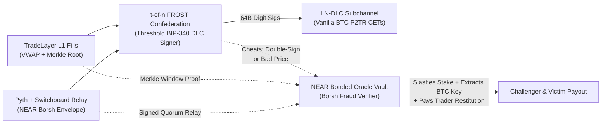

# SatsHedgeZero Protocol Architecture

## 1. Market & Collateral Model

`SatsHedgeZero` replicates the UX of inverse-quoted Lightning derivatives (such as LN Markets) without custody, coordinator spread, or protocol fees:

1. **Collateral Layer (`v0` Vanilla BTC, `v1` Taproot Assets)**:
   - In `v0`, every contract is backed by native Bitcoin satoshis (`CollateralAsset::VanillaBtc`) locked in a 2-of-2 `P2TR` funding/subchannel output.
   - `CollateralAsset::TaprootAsset { asset_id, group_key, script_version }` provides a forward-compatible taptree commitment leaf (`SatsHedgeZero/TapAssetCommitment/v0`) while `validate_v0_funding()` rejects non-BTC funding in `v0`.
2. **Inverse Payoff & Liquidation Equations**:
   - Let $Q$ be integer USD notional, $P_0$ entry BTC/USD, $M_L$ Long margin (sats), $M_S$ Short margin (sats), and $C = M_L + M_S$.
   - Unclamped Long PnL at settlement price $P_T > 0$:
     $$\Delta_L(P_T) = \left\lfloor \frac{Q \cdot 10^8 \cdot (P_T - P_0)}{P_0 \cdot P_T} \right\rceil$$
   - Clamped zero-fee payout split:
     $$\text{Long}(P_T) = \min\!\left(C, \max\!\left(0, M_L + \Delta_L(P_T)\right)\right), \quad \text{Short}(P_T) = C - \text{Long}(P_T)$$
   - Long liquidation bound:
     $$P_{\text{liq},L} = \left\lfloor \frac{P_0 \cdot Q \cdot 10^8}{Q \cdot 10^8 + M_L \cdot P_0} \right\rfloor$$
   - Short liquidation bound:
     - When $M_S \cdot P_0 \ge Q \cdot 10^8$ ($\le 1\times$ short leverage), Short is fully covered and **never liquidates** as $P_T \to \infty$.
     - When $M_S \cdot P_0 < Q \cdot 10^8$ ($> 1\times$ short leverage):
       $$P_{\text{liq},S} = \left\lceil \frac{P_0 \cdot Q \cdot 10^8}{Q \cdot 10^8 - M_S \cdot P_0} \right\rceil$$

## 2. Monotonic Dyadic CET Compression

Naive numeric DLCs require $2^k$ Contract Execution Transactions (e.g., $1{,}048{,}576$ CETs for $k = 20$ binary price digits). Because $\text{Long}(P)$ is monotonically non-decreasing across $[0, 2^k - 1]$, any dyadic prefix $b_0 \dots b_{m-1}$ covering $[L, R]$ has exact payout spread $\text{Long}(R) - \text{Long}(L)$.

`compress_cet_ranges` recursively splits $[L, R]$ only when $\lceil (\text{Long}(R) - \text{Long}(L)) / 2 \rceil > \epsilon_{\max}$:

- Clamped liquidation tails $[0, P_{\text{liq},L}]$ and $[P_{\text{liq},S}, 2^k - 1]$ collapse into logarithmic dyadic prefix covers with **zero** quantization error.
- Active interior regions adapt prefix depth to local inverse convexity $\frac{d\Delta_L}{dP} \propto P^{-2}$.
- Resulting prefixes form a complete, disjoint prefix code over $\{0, 1\}^k$.

## 3. BIP-340 Adaptor Signatures & Multi-Digit Anticipation Points

For an `OracleAnnouncement` with even-Y x-only pubkey $X_{\text{oracle}}$ and pre-committed even-Y digit nonces $R_0, \dots, R_{k-1}$:

1. **Public Anticipation Point** for prefix $b_0 \dots b_{m-1}$ ($1 \le m \le k$):
   $$T(b_0 \dots b_{m-1}) = \sum_{j=0}^{m-1} \left(\text{lift\_x}(R_j) + e_j \cdot \text{lift\_x}(X_{\text{oracle}})\right)$$
   where $e_j = H_{\text{BIP0340}}(R_j \| X_{\text{oracle}} \| H_{\text{digit}}(\text{event\_id}, j, b_j))$.
2. **Parity-Exact BIP-340 Adaptor Signing**:
   - Signer with normalized keypair $(d, P = dG)$ samples deterministic $k_0$ and computes $R_{\text{sum}} = k_0 G + T$.
   - If $y(R_{\text{sum}})$ is even (`r_eff_negated = false`), $s_{\text{adapt}} = k_0 + e d \pmod n$ and completion computes $s = s_{\text{adapt}} + t \pmod n$.
   - If $y(R_{\text{sum}})$ is odd (`r_eff_negated = true`), $R_{\text{eff}} = -R_{\text{sum}}$ has even Y, $s_{\text{adapt}} = -k_0 + e d \pmod n$, and completion computes $s = s_{\text{adapt}} - t \pmod n$.
   - In both cases, summing the oracle's first $m$ attested scalars $t = \sum_{j=0}^{m-1} s_j \pmod n$ yields $tG = T(b_0 \dots b_{m-1})$ and produces a standard 64-byte BIP-340 Schnorr signature on the winning CET.

## 4. Oracle Feeds, `t-of-n` FROST Confederation & NEAR Fraud Proofs

- **Threshold-Nonce FROST Confederation**: Both the confederation key $d$ and per-digit nonces $k_j$ are Shamir-shared with Feldman VSS commitments so *any* $t$-of-$n$ quorum can attest at maturity even if $n - t$ nodes go offline after publishing the announcement. Each partial share $z_{i,j}$ is verified against $(K_{i,j}, Y_i)$ before aggregation (identifiable abort).
- **NEAR Borsh Bonded Fraud Proofs (`NearBondedOracleVault`)**:
  - `EquivocationFraudProof`: Given valid signatures $(R_j, s_0)$ and $(R_j, s_1)$ on bits `0` and `1` for digit $j$, recovers $d = (s_0 - s_1)(e_0 - e_1)^{-1} \pmod n$, verifies $x(dG) = X_{\text{confed}}$, slashes 100% of the NEAR bond, and outputs $d$ to sweep any L1 Bitcoin slash-bond UTXO.
  - `DeviationFraudProof`: Given a single valid FROST attestation $P_{\text{frost}}$ that diverges beyond `max_deviation_bps + conf_bps` from Borsh-verified `Pyth`+secondary relay quorums and/or witness-signed `TradeLayerVwapProof` windows, slashes the confederation's NEAR bond, rewards the challenger, and calculates exact satoshi shortfall restitution for harmed DLC traders.
