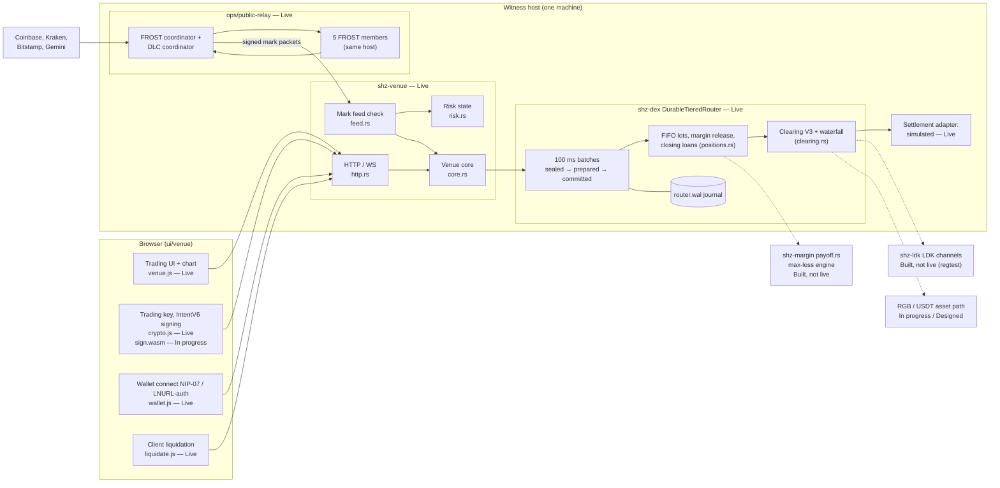

# Lightninger architecture

Lightninger (formerly SatsHedgeZero) is a testnet4 venue for inverse BTC/USD perpetuals, with
options in progress. Traders sign orders in the browser; a durable batching router matches them
in 100 ms windows; a multilateral clearing step turns each committed batch into one net amount
per account; a settlement adapter moves those nets. A FROST 3-of-5 relay signs the mark price and
attests 15-minute DLC events.

Public deployment: https://shz-venue.170-75-168-145.sslip.io/ (the witness host, one machine).
`/api/status` reports `production_ready: false`. Status as of 2026-11-27, `main` at `475ab04`;
the per-track evidence table is [SHZ_PRODUCT_ROADMAP.md](SHZ_PRODUCT_ROADMAP.md).

Every component below carries one status:

| Status | Meaning |
|---|---|
| **Live** | Runs on the testnet host today |
| **Built, not live** | Code and tests on `main`; not deployed or not wired into the venue |
| **In progress** | Being built now: partly on `main`, in a working tree or on a branch |
| **Designed** | Agreed design; no code |

The contract math of the original v0.1.0 workspace (inverse payoff, liquidation bounds, dyadic
CET compression, BIP340 adaptor signatures, NEAR fraud proofs) is in `crates/shz-dlc` and
`crates/shz-oracle`; the previous version of this file (commit `9fe7ba4`) states it.

## 1. Components



### 1.1 Browser client — Live (WASM signing In progress)

`ui/venue` is the whole client: order entry, book, BitcornWisdom chart (Classic mode toggle),
and the plumbing explorer (`explorer.html`) that links a fill to its mark packet and batch.

* **Keys stay in the browser.** The page holds a BIP340 trading key and signs `IntentV6` orders,
  batch approvals and owner channel acks. The venue verifies raw BIP340 signatures over
  venue-chosen 32-byte digests.
* **WASM secret-key operations — In progress.** `crates/shz-wasm-sign` (k256 BIP340 sign,
  x-only pubkey, BIP341 secret tweak, keygen) compiles to `ui/venue/sign.wasm`; `crypto.js` calls
  it since `475ab04` (25 Node tests pass). The live host still serves the JS-only `crypto.js`
  (fetched 2026-11-27: no `wasm` reference, `/sign.wasm` returns 404).
* **Wallet connect — Live.** A Nostr NIP-07 or LNURL-auth (LUD-04) wallet authorizes the trading
  key once, 24 h expiry, journaled; both keys sign the same link hash (`wallet.rs`, `2095361`,
  `f4256d2`). The wallet never signs approvals itself. No real wallet has been run against the
  host yet; WebLN shows an alias only.
* **Client liquidation — Live.** `liquidate.js` executes the venue's partial-liquidation plan
  with the account's own key (section 1.7).

### 1.2 Venue — Live

`crates/shz-venue` is one binary behind Caddy (`ops/venue-deploy`). One market,
`SHZ-BTCUSD-INV`; leverage 0.1x to 10x (`leverage_bps` 1,000 to 100,000).

* `http.rs`: REST and WebSocket API ([SHZ_VENUE_API.md](SHZ_VENUE_API.md)).
* `core.rs`: account registry, order admission, batch window clock, settlement driver
  (`advance_settlement`), deadline abort, status.
* `feed.rs`: pulls relay packets and verifies the 3-of-5 group signature on every packet before
  it becomes the mark.
* `risk.rs`: per-account margin ratio on every mark (section 1.7).
* `wallet.rs`: wallet links (section 1.1).

Accounts are demo credit (200,000 sats, `TESTNET DEMO CREDIT`) or `utxo` accounts: the venue
checks a testnet4 output is unspent, P2TR to the owner's key, with one confirmation (`f1a4749`).
The output is not locked, so `utxo` equity is a ledger number. The `ops/venue-mm` market makers
run on the same host and poll every 0.25 s.

### 1.3 Router, batches, acks, journal — Live

`shz_dex::routing::tiered_durable::DurableTieredRouter` wraps the tiered router with a
write-ahead journal. Every command is a journal record; restart replays it.

* **Windows.** Orders accumulate in 100 ms windows; at window end the batch is **sealed**.
* **Approvals → prepared.** Each owner in the batch signs the batch approval; the batch becomes
  **prepared**.
* **Acks → committed.** Each lane needs three signatures on the channel ack: owner, peer and
  monitor. All three present: **committed**. Batches resolve strictly in sequence.
* **Deadline abort** (`92b8258`). A head batch still sealed or prepared `ABORT_AFTER_US` (10 s)
  past its window is fenced and aborted, so one silent owner cannot hold every later batch.
  Since `4139713` a fully signed head batch whose resolve keeps failing is aborted the same way.
* **Journal.** `router.wal` plus `fees.wal`; 48,261 records on the live host (2026-11-27). Both
  are opened without a pinned tip (`core.rs:249`, `core.rs:271`), so a rolled-back volume is not
  detected.

### 1.4 Positions — Live

`routing/positions.rs` keeps each account's open lots FIFO (`Lot { side, qty, price, margin,
opp_margin }`).

* **Margin release** (`0c6e924`): committed positions net, and an offsetting fill releases the
  margin of the lots it closes.
* **Closing loans** (`bf4d556`, `4afb718`, `45f8bbc`): a closing leg borrows its margin from the
  lots it closes, behind a journaled switch that is on in production. Router F1 (`4139713`)
  counts an account's loans in later in-flight batches (`other_loans`), so two closing takes in
  different windows both commit.
* **One closing loan in flight per account**: the venue refuses a second reducing take while the
  account has an unsettled closing batch (`core.rs:666`, SHZ_LIQUIDATION_DRILL.md F1).

### 1.5 Clearing V3 and the waterfall — Live (fund is ledger-only)

`routing/clearing.rs`, [SHZ_VENUE_CLEARING.md](SHZ_VENUE_CLEARING.md). Switched on 2026-11-26
(`60174a0`).

* The venue is the central counterparty. Each committed batch clears to **one net sats amount
  per account** (`ClearingRow::net`).
* A loser's shortfall is covered in order, and the row records the deepest layer used:
  **Margin → OwnClaim → Fund → Haircut → Carried**. `OwnClaim` is the account's own deferred
  claim from earlier batches; `Haircut` is pro rata on every outstanding winning claim;
  `Carried` moves the remainder to the next batch.
* Winners are valued uncapped. Gains the pool cannot pay now become **deferred claims**, paid
  in later batches.
* **Solvency identity** `cash − claims − fund + carry == book`, checked every batch;
  `/api/status` shows `identity: 0`, `carry: 0` live.
* **Clearing fund**: 1,000,000 sats (`fund0`) on the ledger. No coins back it.

### 1.6 Margin and max-loss — perp rule Live; max-loss engine Built, not live

* **Live:** the perp rule in the router: clamped inverse payoff per lot, initial margin from
  leverage, FIFO release.
* **Built, not live:** `crates/shz-margin/src/payoff.rs` (`18307a0`,
  [SHZ_MAXLOSS_MARGIN.md](SHZ_MAXLOSS_MARGIN.md)). Margin = worst-case loss of the portfolio over
  all settlement prices, computed exactly by checking breakpoints (the doc's "Why checking
  breakpoints is exact"). Covers perps, inverse calls, USD puts and spreads; 17 tests including a
  400-portfolio brute-force check. The router does not call `margin_delta` yet.

### 1.7 Risk and liquidation — Live (client-executed)

`crates/shz-venue/src/risk.rs`, `ui/venue/liquidate.js`,
[SHZ_LIQUIDATION_DRILL.md](SHZ_LIQUIDATION_DRILL.md).

* On every mark, each account gets a state from its margin ratio: warning below 750 bps,
  maintenance below 500 bps (reduce-only gate: the venue refuses risk-increasing orders), target
  restore 800 bps, maximum auction discount 200 bps over 60 s.
* The venue publishes a partial-liquidation plan (full close when no partial close restores the
  ratio); the account's page executes it with the account's key. Liquidation closes trade on
  the Standard tier (0 taker fee) and use the closing loan.
* The drill (`cc9a79b`, fixes `f785f47`, asserts `603e834`) runs the whole path with a scripted
  mark on a local venue. No live account has breached.
* **Not built:** server-side liquidation. An account with its page closed keeps only the
  contract backstop (the lot stops at its bankruptcy price).

### 1.8 Oracle relay, FROST, DLC oracle — Live (single operator)

`ops/public-relay` (Python services on the host), `crates/shz-relay`, `crates/shz-oracle`,
[SHZ_HFT_06_ORACLE_RELAY.md](SHZ_HFT_06_ORACLE_RELAY.md).

* **Mark packets — Live.** Every 5 s the coordinator reads Coinbase, Kraken, Bitstamp and Gemini,
  members sign a VALID packet only near their own price reading (F-03), and the 3-of-5 FROST
  group key `403c4966…fdb8` signs a hash-chained BIP340 packet. Two members down keeps signing;
  three down pauses.
* **Coordinator authentication — Live** (F-05, `f52c3e9`, deployed `27450ad`): members accept
  only HMAC-authenticated coordinator requests.
* **DLC oracle — Live.** 15-minute BTC/USD events, per-event Feldman nonce DKG, 20-digit
  attestations 9.0 to 10.2 s after maturity (`daf5cba`). A threshold-signed unattestable notice
  is exclusive with attestation, and refund tooling exists (`c2bbf8d`, `20a8edc`, regtest only).
* **Hardening.** F-11 (connection, subscriber and event-file bounds) fixed on `main` in
  `6664807`, deployment in progress. F-12 (Rust member parent ratchet persisted) fixed in
  `87a971c`.
* **Rust FROST member — In progress** (`crates/shz-frost-member`).

### 1.9 Settlement adapters

| Adapter | Status | What it does |
|---|---|---|
| Simulated | **Live** | The venue holds every lane's peer and monitor keys and signs those acks itself (`core.rs:932`, `"adapter": "simulated"`). Nets move only on the ledger |
| LDK channels, `crates/shz-ldk` | **Built, not live** | One LDK node for the venue, one per account, one channel per lane; each net is a direct keysend. The persisted channel state of both parties is bound into the V3 ack. Crash-safe since G-LN-1b (`07959f8`): manager before monitors on disk, restart from disk, a prepared batch resumes without paying a lane twice. Regtest on Core 31.1 only; [SHZ_LDK_SETTLEMENT.md](SHZ_LDK_SETTLEMENT.md) |
| RGB / USDT | **In progress** (qualification), **Designed** (integration) | Utexo SDK qualification on `research/shz-rgb-01-utexo-sdk` (PR #33). No adapter code on `main` |
| Per-trade DLC funding and CETs | **Designed** | CET settle and refund drilled on regtest (`20a8edc`); not connected to venue fills. CET pre-signing measured 17.2 s for 19,192 CETs per contract |

Margin is not in the channel: DLC collateral stays outside LDK commitments
(SHZ_HFT_06_LDK.md); the channel carries the net cash the clearing moves.

### 1.10 Options and combos — In progress

`routing/options.rs` (working tree, not on `main` at `475ab04`),
[SHZ_OPTIONS_COMBOS.md](SHZ_OPTIONS_COMBOS.md). Orders are `IntentV7`, a new owner-signed intent
version beside the perpetual `IntentV6`; margin comes from the max-loss engine.

## 2. Trade lifecycle

```mermaid
sequenceDiagram
  participant B as Browser (trading key)
  participant V as Venue (shz-venue)
  participant R as Router + journal
  participant O as FROST relay
  participant S as Settlement adapter
  O->>V: signed mark packet (5 s), group sig verified
  B->>V: IntentV6 post / take / cancel (BIP340)
  V->>V: admission: signature, leverage, reduce-only gate, one closing loan in flight
  V->>R: submit (journaled)
  R->>R: match into the open 100 ms window
  R->>R: window ends → batch SEALED
  V-->>B: approval due (account event)
  B->>V: batch approval
  R->>R: all owners approved → PREPARED
  V-->>B: ack due
  B->>V: owner ack
  S->>V: peer + monitor acks (simulated: venue-held keys)
  R->>R: 3 acks per lane → COMMITTED (or deadline abort at +10 s)
  R->>R: positions: FIFO lots, margin release, closing loans
  R->>R: clearing V3: one net per account, waterfall
  R->>S: nets for the batch
  S-->>V: settled (live: ledger; LDK: keysends on regtest)
```

1. **Intent.** The page signs an `IntentV6` with the trading key (authorized by a wallet link or
   used directly). The venue checks the signature, leverage bounds, the account's risk state
   (reduce-only below 500 bps) and the one-closing-loan guard.
2. **Match.** The router matches against resting quotes inside the current 100 ms window.
   Every accepted command is journaled before it changes state.
3. **Batch.** At window end the batch is sealed with its fills and planned lane updates.
4. **Approvals.** Every owner in the batch signs the approval → prepared.
5. **Acks.** Owner, peer and monitor sign each lane's channel ack → committed. Today peer and
   monitor are the simulated adapter. A missing signature past +10 s aborts the batch.
6. **Positions.** Committed fills update FIFO lots, release offset margin and book closing loans.
7. **Clearing.** The batch clears to one net per account through the waterfall; deferred claims
   and carry roll forward; the solvency identity is checked.
8. **Settlement.** The adapter moves the nets: on the ledger live, by LDK keysend per lane on
   regtest.

Latency on the host: take ack 21 ms, committed 235 ms; from a laptop over the internet: take ack
253 ms, committed 1.28 s ([SHZ_VENUE_LATENCY.md](SHZ_VENUE_LATENCY.md)).

## 3. Trust assumptions today

| Assumption | Where it is today | What removes it |
|---|---|---|
| One operator runs everything | Venue, router, relay coordinator and all five FROST members on one host | Members on separate hosts and operators (G-FED-1) |
| FROST key generation | Trusted dealer: one process saw the group secret | DKG (G-FED-1, G-FED-2) |
| Settlement | Simulated: the venue signs peer and monitor acks; nothing moves on chain or in a channel | LDK adapter on testnet4 (G-LN-1), then the venue stops holding those keys |
| Collateral | Demo credit; `utxo` outputs checked once, not locked | Collateral locked in a DLC or channel output |
| Clearing fund | 1,000,000 sats on the ledger, no coins | Funded testnet4 output sized from observed shortfalls |
| Price data | Public exchange APIs, unauthenticated feed | Licensed Pyth Pro / Chainlink feeds (G-SRC-1, G-SRC-2) |
| Liquidation | Executed by the account's own open page | Server-side liquidation |
| Journal integrity | Tips not pinned; a restored backup is not detected | Pinned router and fee-ledger tips |
| Review | Internal HFT-06 review, F-01..F-14 tracked | External review (G-SEC-1) |

Lightninger is not non-custodial today: accounts are ledger entries and the adapter holds the
peer and monitor keys.

## 4. Hybrid multi-asset clearing — Designed

Agreed design, no code on `main`. The RGB qualification (section 1.9) is the first step.

* **Asset registry.** A general registry of settlement assets. BTC is primary; USDT is the first
  stablecoin, on RGB first and Taproot Assets later.
* **Per-asset everything.** Each asset has its own nets, pools, clearing fund and waterfall.
  No cross-asset netting: a BTC loss is never covered from a USDT gain or the reverse.
* **Inverse perps** margin and settle in BTC, as today.
* **Options** margin in BTC. **Puts may co-settle in USDT**, so a put writer can post the strike
  in USDT and be fully capped (cash-secured).
* **Fully funded positions are exempt from liquidation**: a position whose worst-case loss is
  already posted cannot breach.
* The max-loss engine already keeps assets apart (SHZ_MAXLOSS_MARGIN.md "Assets and units");
  USD-quoted puts stay disabled until a Bitcoin-native USD asset settles.

```
            ┌──────────── batch N committed ────────────┐
            │                                            │
  BTC leg: perps, calls, BTC-margined puts      USDT leg: co-settled puts
            │                                            │
  net per account (sats)                        net per account (USDT units)
  margin → claim → BTC fund → haircut           margin → claim → USDT fund → haircut
            │                                            │
  LN / LDK channel                              RGB (then Taproot Assets) transfer
```

## 5. Where to read the code

| Area | Path |
|---|---|
| Venue binary, API, settlement driver | `crates/shz-venue/src/{main,http,core}.rs` |
| Mark feed verification | `crates/shz-venue/src/feed.rs` |
| Risk and liquidation plan | `crates/shz-venue/src/risk.rs`, `ui/venue/liquidate.js` |
| Wallet connect | `crates/shz-venue/src/wallet.rs`, `ui/venue/wallet.js` |
| Browser client and signing | `ui/venue/{venue,crypto,settings}.js`, `crates/shz-wasm-sign` |
| Durable router, batch phases, deadline abort | `crates/shz-dex/src/routing/{tiered,tiered_durable,durable}.rs` |
| Positions, margin release, closing loans | `crates/shz-dex/src/routing/positions.rs` |
| Clearing V3 | `crates/shz-dex/src/routing/clearing.rs`, tests `crates/shz-dex/tests/hft06_clearing.rs` |
| Options (IntentV7) | `crates/shz-dex/src/routing/options.rs` |
| Fee ledger, Lightning adapter trait | `crates/shz-dex/src/routing/ln_fees.rs` |
| Max-loss margin | `crates/shz-margin/src/payoff.rs` |
| LDK settlement | `crates/shz-ldk/src/{adapter,node,journal}.rs`, `crates/shz-ldk/tests/regtest_settlement.rs` |
| FROST relay and DLC coordinator (deployed) | `ops/public-relay/{public_relay,frost_relay,frost_signer,dlc_coord,dlc_oracle}.py` |
| Relay in Rust, FROST member | `crates/shz-relay`, `crates/shz-frost-member` |
| DLC primitives (adaptor sigs, CETs) | `crates/shz-dlc/src/lib.rs` |
| Deployment | `ops/venue-deploy`, `ops/venue-mm`, `ops/venue-bench` |
| Research, not on the venue path | `crates/shz-utxoref`, `crates/shz-nova-bitvm`, `crates/shz-ln-testnet4`, `crates/shz-oracle` |

Related documents: [SHZ_VENUE_API.md](SHZ_VENUE_API.md), [SHZ_VENUE_CLEARING.md](SHZ_VENUE_CLEARING.md),
[SHZ_VENUE_LATENCY.md](SHZ_VENUE_LATENCY.md), [SHZ_LIQUIDATION_DRILL.md](SHZ_LIQUIDATION_DRILL.md),
[SHZ_LDK_SETTLEMENT.md](SHZ_LDK_SETTLEMENT.md), [SHZ_MAXLOSS_MARGIN.md](SHZ_MAXLOSS_MARGIN.md),
[SHZ_OPTIONS_COMBOS.md](SHZ_OPTIONS_COMBOS.md), [SHZ_PRODUCT_ROADMAP.md](SHZ_PRODUCT_ROADMAP.md),
[SHZ_HFT_06_SECURITY_REVIEW_FINDINGS.md](SHZ_HFT_06_SECURITY_REVIEW_FINDINGS.md).
