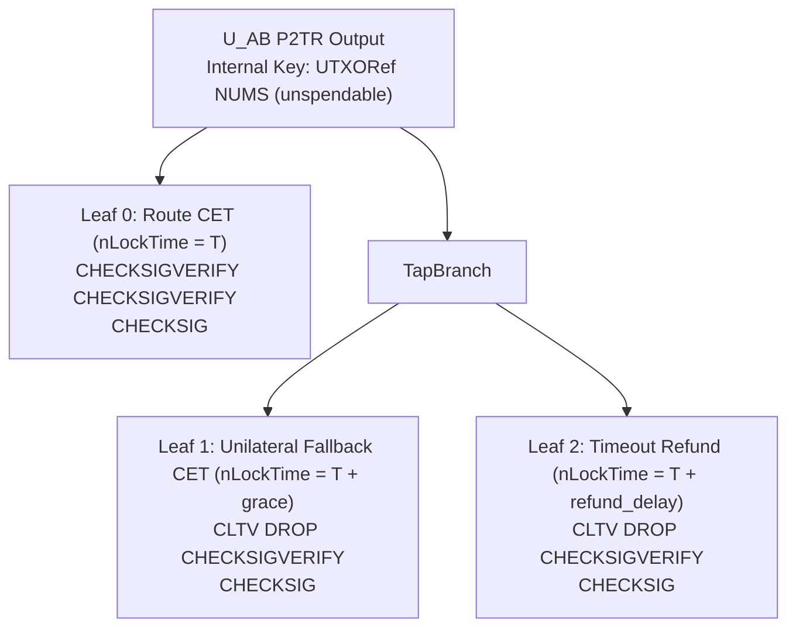

# SHZ-MNR-02: Bob-Offline Multilateral Closeout with Bitcoin-Enforceable Settlement

Addresses [Issue #2 (`SHZ-MNR-02`)](https://github.com/patrickdugan/SatsHedgeZero/issues/2) and supplies the Bitcoin spending and collateral-release layer missing from [PR #1 (`SHZ-MNR-01`)](https://github.com/patrickdugan/SatsHedgeZero/pull/1).

## 1. Candidate Construction Matrix

| Candidate | Bob Offline at Maturity ($h \ge T$)? | Raw $U_{AB}$ Spend Before Maturity ($h < T$) w/ Bob Offline? | Discretionary Committee Custody? | Unilateral Exit Preserved? | Soft Fork / Covenant Needed? | Verdict |
| --- | :---: | :---: | :---: | :---: | :---: | --- |
| **1. Fresh Mutual Signatures** (`0x00` / `0x01`) | No | No | No | Yes | No | Optimal baseline (`1` key/script spend) when Bob is online; halts immediately once Bob's signer goes offline. |
| **2. Origination `0x83` + Two-Tier `CLTV` Tree** | **Yes (Core-confirmed)** | No | **No** | **Yes (`Leaf 1` @ $T+\Delta_g$, `Leaf 2` @ $T+\Delta_r$)** | **No** | **Primary L1 settlement mechanism**: enforces multilateral routing directly in Bitcoin Core consensus at maturity without Bob online and without committee custody. |
| **3. DLC-Channel Conditional Clearing** | No (off-chain); falls back to #2 on L1 | No | No | Yes | No | Off-chain LN-DLC subchannel state updates require Bob's interactive revocation/commitment signature; when Bob is offline, settlement drops to L1 CETs (#2). |
| **4. LP-Funded Close Advance over #2** | **Yes** | **Economic liquidity at $h < T$** (via LP's UTXO) | **No** | **Yes** | **No** | Provides immediate pre-maturity liquid BTC to Alice at $t_1 < T$ from an LP's separate UTXO, collateralized by co-signing the priority `Leaf 0` ($h = T$) routed claim on $U_{AB}$. |

## 2. Exact Taproot Script Tree & `SIGHASH` Construction (`shz-utxoref::mnr02`)

Funding output $U_{AB}$ locks `alice_margin_sats + bob_margin_sats` under the unspendable `UTXORef` NUMS internal key (`c99e9965166e7ff80516494709db8fdfdc31b0626500bb70dc3652fc2ff584ab`), disabling key-path bypass and committing to three Tapscript (`0xc0`) leaves:



### How Origination Pre-Signing (`t = 0`) Enables Offline Routing (`t = 1`)

1. **Origination (`t = 0`, Bob Online, Carol Unknown)**:
   - Before funding $U_{AB}$, Alice and Bob verify:
     - **Leaf 2 (`refund_leaf`)**: Plain 64-byte BIP-340 `SIGHASH_DEFAULT (0x00)` signatures spending $U_{AB}$ at `nLockTime = T + refund_delay` back to `(Bob, Alice, 330-sat anchor)`.
     - **Leaf 1 (`unilateral_cet_leaf`)**: Standard `SIGHASH_DEFAULT (0x00)` Schnorr adaptor signatures under each outcome point $T(P_2)$ at `nLockTime = T + grace`.
     - **Leaf 0 (`route_cet_leaf`)**: Bob signs an `AdaptorSignature` under $T(P_2)$ over a 1-input, 1-output template (`nLockTime = T`, `nSequence = 0xfffffffe`) using **`SIGHASH_SINGLE | SIGHASH_ANYONECANPAY (0x83)`**, where `Output 0 = (bob_payout(P_2), bob_spk)`.
   - By BIP-341, `hash_type = 0x83` omits `sha_prevouts`, `sha_amounts`, `sha_scriptpubkeys`, `sha_sequences`, and `sha_outputs`, committing **strictly** to `Input 0` (`U_AB`) and `sha_single_output` (`Output 0`). Carol does not need to exist at `t = 0`.

2. **Closeout Match (`t = 1 < T`, Bob Offline)**:
   - Bob's signer goes offline permanently after $U_{AB}$ confirms.
   - Alice matches an offsetting inverse Short with Carol at `$55,000` (fixing Alice's net PnL at `+9,090,909 sats` across the entire outcome grid on `$50,000` notional vs `$50,000` entry).
   - Alice and the non-custodial `P_RouterGuard` (one-shot anti-replay registrar / Carol's guard key) sign `SIGHASH_ALL (0x01)` on `Leaf 0` (`nLockTime = T`) over the full output vector:
     - `Output 0`: `bob_payout(P_2)` $\to$ `bob_spk` (**immutable**; tampering by 1 sat invalidates Bob's `0x83` signature in Bitcoin Core),
     - `Output 1`: `7,575,757 sats` $\to$ `carol_spk` (at $P_2 = \$60,000$),
     - `Output 2`: `alice_margin + 9,090,909 - fee - 330` $\to$ `alice_spk`,
     - `Output 3`: `330 sats` $\to$ `anchor_spk` (CPFP fee-bump anchor).

3. **Maturity Enforcement (`t = 2`, Height $= T$, Bob Still Offline)**:
   - The `3-of-5` FROST confederation attests $P_2 = \$60,000$, revealing scalar $t(\$60,000)$.
   - Completing Bob's `0x83` adaptor signature yields the 5-element witness stack:
     `[bob_sig_65B_0x83, guard_sig_65B_0x01, alice_sig_65B_0x01, route_cet_script, route_control_block_65B]`.
   - **No Route Diversion by Alice**: During blocks `[T, T + grace - 1]`, Alice's unilateral `Leaf 1` (`nLockTime = T + grace`) is rejected by Bitcoin Core with `non-final`, giving Carol/LP an exclusive `[T, T + grace - 1]` confirmation window to settle `Leaf 0`.
   - **No Committee Custody**: `P_RouterGuard` cannot spend $U_{AB}$ without **both** Alice's `0x01` signature and Bob's oracle-unlocked `0x83` signature.
   - **Unilateral Exit Preserved**: If Carol/LP disappears before co-signing `Leaf 0`, `Leaf 1` becomes consensus-final at height `T + grace` and `Leaf 2` becomes consensus-final at height `T + refund_delay`.

## 3. Pre-Maturity Impossibility Proof & Risk Accounting

- **Why raw $U_{AB}$ collateral cannot be released on-chain at $h < T$ with Bob offline**:
  At $h < T$, no oracle scalar $t(P_2)$ exists, and Bob's `0x83` / `0x00` signatures commit to `nLockTime >= T` and `TapLeaf` scripts requiring `<P_Bob>`. Without a covenant/state-machine opcode (such as `OP_CAT` / `OP_CTV` + `SIGHASH_ANYPREVOUT`) that allows novating Alice's slot inside $U_{AB}$ while preserving Bob's future state transitions, **no Bitcoin transaction can spend $U_{AB}$ prior to height $T$ without Bob's live signature or trusted third-party key custody**.
- **Risk & Loss-Absorption Schedule**:
  - **Outcome-grid rounding**: Capped at `<= 1 sat` between toward-zero bilateral inverse legs; absorbed by Alice's dust buffer.
  - **L1 miner fees & fee pinning**: Every `Leaf 0`, `Leaf 1`, and `Leaf 2` transaction commits a dedicated `330-sat` CPFP anchor output so either Alice, Carol, or an LP watchtower can attach high-feerate wallet inputs without invalidating Bob's `0x83` signature (`ANYONECANPAY` also permits direct input attachment on `Leaf 0` if re-signed by Alice + Guard).
  - **Deep reorg across `[T, T + grace]`**: If an LP advances liquid BTC at $t_1 < T$ (Candidate 4), a chain reorganization exceeding `grace_blocks` at height $T$ could reopen `Leaf 1` competition; `grace_blocks` (e.g. `18–72` blocks in production vs `6` in fast regtest) bounds LP reorg exposure.

## 4. Reproducing the Live Bitcoin Core 31.1 Regtest Suite

```sh
cargo run --bin shz -- mnr02-regtest /path/to/bitcoind
```

See [`evidence/mnr02_core_regtest_receipt.json`](../evidence/mnr02_core_regtest_receipt.json) for recorded Bitcoin Core 31.1 transaction hexes, witness stacks, block hashes, adversarial rejections, CPFP child confirmation, and 6-block reorganization results.
