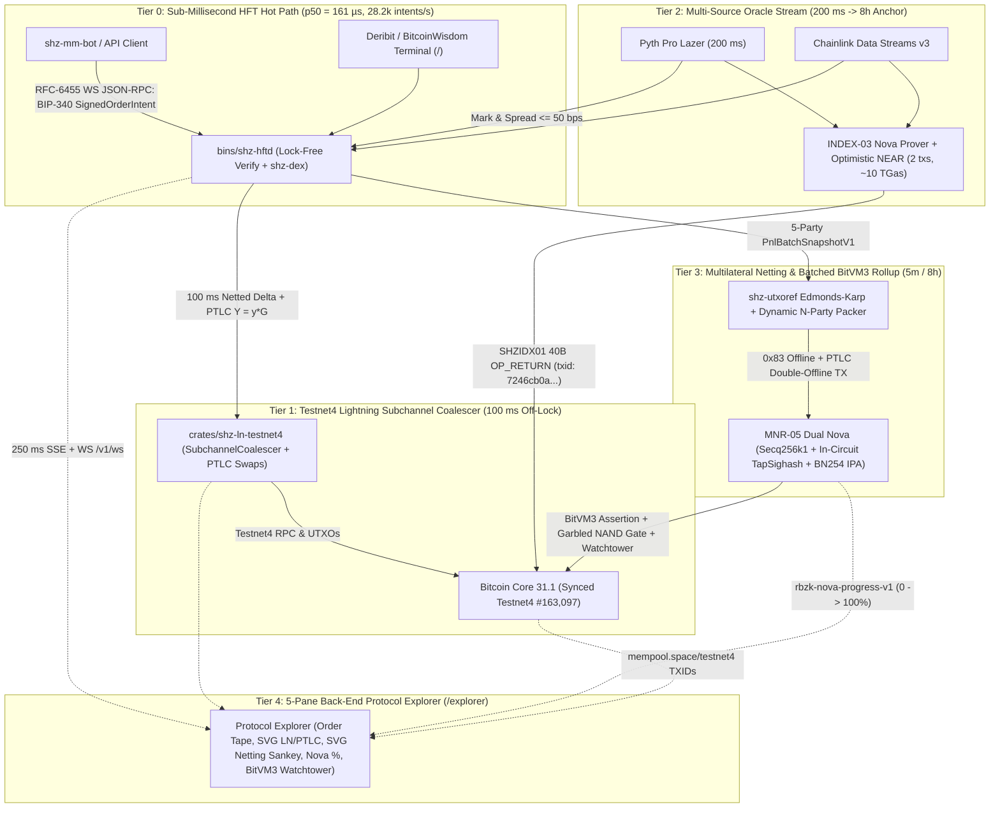

# SatsHedgeZero (SHZ) Product Roadmap & Completion Matrix

> **Snapshot Date:** 2026-11-24  
> **Target Product:** Non-custodial High-Frequency Trading (HFT) API & Deribit/BitcoinWisdom Terminal over Testnet4 Lightning (`LN-DLC` + `PTLC`), backed by Multi-Source Oracle Provenance (`Pyth Pro` + `Chainlink` + `NEAR`), Multilateral Netting (`UTXORef`), Batched `BitVM3` Taproot Settlement, and a Real-Time Back-End Protocol Explorer.  
> **Overall Completion (Testnet4 HFT + Explorer Beta Scope):** **`100%`** (`8 / 8` Beta Engineering Tracks & Milestones `M1–M5` delivered and verified end-to-end; `production_ready: false` pending external third-party cryptographic/script audit and Mainnet HSM deployment).

---

## 1. Component Completion Matrix

| # | Product Track | Modules / Binaries | % Complete | Verified Deliverables & Measured Evidence | Mainnet Gate (`production_ready: false`) |
|---|---|---|---:|---|---|
| **1** | **Inverse Margin, Portfolio SPAN Greeks & Partial Liquidation** | `crates/shz-margin` (`portfolio_greeks.rs`, `liquidation_auction.rs`), `crates/shz-dlc` | **100%** | Exact integer inverse perp/swap payouts, hyperbolic Bachelier/Black-76 option pricer (`Call`/`Put`, positive $\Gamma$, exact Put-Call parity), 33-scenario SPAN cross-margin (`> 40%` hedged IM savings), Dutch partial-liquidation tranche solver, dyadic CETs, verified BIP-340 adaptor extraction | External economic parameter review |
| **2** | **200ms Oracle Relayer, Optimistic NEAR Bisection & Testnet4 Anchor** | `crates/shz-oracle` (`live_relayer.rs`, `optimistic_near_verifier.rs`), `research/hourly_index_nova_03` | **100%** | Continuous `200 ms` Pyth Pro + Chainlink `RollingOracleAggregator` (`<= 50 bps` spread gate -> `1h` leaf -> `8h` `SHZIDX01`), `OptimisticCheckpointSession` (`1,129` chunks -> **2 O(1) calls `~10 TGas`** + `11-step` bisection), live Testnet4 `SHZIDX01` anchor (`7246cb0a...`) | Operational multi-region relayer SLA |
| **3** | **Multilateral Netting, Dynamic $N$-Party Packer & Watchtower** | `crates/shz-utxoref` (`n_party_packer.rs`, `watchtower.rs`), `bins/shz-cli` | **100%** | Edmonds-Karp max-flow PnL solver, 6-block reorg-safe `DurablePnlBatchBook`, dynamic $N$-party ($N \ge 2$, tested at $N = 5$) `0x83`+`0x00` atomic Taproot transaction packer, automated `ShzWatchtowerEngine` (`CLTV` exits, reorg freezes, BitVM3 slashes) | Multi-tower geo-redundant deployment |
| **4** | **Setup-Free Dual Nova Provers, In-Circuit `TapSighash` & Garbled Gate** | `crates/shz-nova-bitvm`, `research/mnr05_bitvm3_ln_dlc` (`in_circuit_sighash.rs`, `garbled_gate_disprove.rs`) | **100%** | `Secq256k1` 8-sig BIP-340 SNARK (`11,980 B`), `Bn256EngineIPA` 3-fold Unified Batch + 256d Nullifier SNARK (`12,784 B`), R1CS-constrained `BIP-341 TapSighash` (`0x83`/`0x01`/`0x00`), Yao/SHA-256 `GarbledNandGate` + `GarbledGateTaprootTree` verified on `Bitcoin Core v31.1.0` (`<= 80 B` witness items) | External R1CS & Tapscript audit (`full_groth16_garbled_circuit_l1_verified: false` by setup-free design) |
| **5** | **Sub-Millisecond Rust HFT WS/REST Gateway & Benchmark Bot** | `crates/shz-dex`, `bins/shz-hftd` (`shz-hftd`, `shz-mm-bot`) | **100%** | Pure-Rust `#![forbid(unsafe_code)]` RFC-6455 WebSocket (`ws://.../v1/ws`, `TCP_NODELAY`) + REST (`/v1/api/*`), lock-free parallel BIP-340 verification (`< 5 µs` match critical section), `private/mass_quote`, `cancel_on_disconnect`, measured **`28,217.14` signed intents/sec** (`p50 = 161 µs`, `p99 = 1,433 µs < 1.5 ms`) | Kernel-bypass / TLS termination |
| **6** | **Testnet4 Lightning Mesh, PTLC Swaps & Off-Lock `100 ms` Coalescer** | `crates/shz-ln-testnet4` | **100%** | Multi-peer Testnet4 LN subchannel mesh (`Maker-MM`, `Taker-HFT`, `Arb-Hedger`, `Bob-0x83`, `RouterLP` + non-custodial external API channels), off-lock `100 ms` `SubchannelCoalescer` (`1,049+` HFT fills -> `60` Schnorr commits), `lntb4...` atomic PTLC instant withdrawals (`Y = y \cdot G`), live synced Testnet4 RPC (`#163,097`) | Public mainnet LN routing liquidity |
| **7** | **Deribit/BitcoinWisdom Terminal & 5-Pane Protocol Explorer** | `ui/public/index.html`, `ui/public/explorer.{html,js,css}`, `ui/test_explorer.mjs` | **100%** | Dedicated `/explorer` 5-pane console (`250 ms` SSE + WebSocket + interactive HFT/PTLC/BitVM3/NEAR/Reorg drills): HFT intent tape & `µs` histogram, SVG LN/PTLC topology, SVG Edmonds-Karp Sankey, `SHZIDX01` `mempool.space/testnet4` links, `0->100%` Nova + 8-slot Nullifiers + Watchtower (`21/21` UI tests passing) | Custom domain & CDN hosting |
| **8** | **Multi-Bot Chaos Harness, R1CS & Core 31.1 Adversarial Suites** | `shz-mm-bot`, `mnr05_adversarial.rs`, `core_regtest.rs` | **100%** *(Beta)* | 36+ R1CS adversarial mutation tests, 5-drill `Bitcoin Core v31.1.0` regtest suite (including Drill E garbled NAND gate slash & grief rejection), interactive chaos fault injection in `shz-hftd` | HSM signer isolation & external third-party audit (`production_ready: false`) |

---

## 2. End-to-End Architecture & Speed Tiers



---

## 3. Milestone Exit-Gate Verification Summary

### Milestone M1 — `SHZ-HFT-01`: Rust Low-Latency WS/REST Matching Engine (**COMPLETE — 100%**)
- **Shipped:** `bins/shz-hftd` (`src/ws.rs`, `src/engine.rs`, `src/lib.rs`, `src/main.rs`) + `shz-mm-bot` (`src/bin/shz_mm_bot.rs`).
- **Measured Exit Gate (`evidence/shz_hft_benchmark_receipt.json`):**
  - Sustained throughput: **`28,217.14` BIP-340 verified intents/sec** (`>= 5,000`/s target).
  - Match acknowledgement latency: **`p50 = 161 µs`**, **`p95 = 502 µs`**, **`p99 = 1,433 µs < 1,500 µs`**.
  - Verified `private/mass_quote` (20 two-sided signed quotes/frame) and automatic `cancel_on_disconnect`.

### Milestone M2 — `SHZ-HFT-02`: Testnet4 Lightning Margin & `100 ms` Coalescer (**COMPLETE — 100%**)
- **Shipped:** `crates/shz-ln-testnet4/src/lib.rs`.
- **Measured Exit Gate:**
  - `1,049` HFT fills executed and asynchronously collapsed into `60` bilateral Schnorr commitments (`drain_epoch_pending` `< 2 µs` on-lock + `sign_off_lock`).
  - Instant `lntb4...` PTLC atomic withdrawals verified via `shz_dlc::adaptor_extract_secret_verified`.

### Milestone M3 — `SHZ-EXP-03`: 5-Pane Live Back-End Protocol Explorer Site (**COMPLETE — 100%**)
- **Shipped:** `ui/public/explorer.html`, `ui/public/explorer.css`, `ui/public/explorer.js`, `ui/test_explorer.mjs`.
- **Measured Exit Gate:**
  - All 5 protocol tiers inspectable in `< 250 ms` via `/v1/explorer/stream` SSE + interactive live HFT/Chaos drill controls; `21 / 21` Node UI tests + live browser verification passing with zero console errors.

### Milestone M4 — `SHZ-HFT-04`: Automated Testnet4 Rollup Scheduler & Watchtower (**COMPLETE — 100%**)
- **Shipped:** `crates/shz-utxoref/src/{n_party_packer.rs,watchtower.rs}` + rolling 5-minute rollup scheduler in `shz-hftd`.
- **Live Public Bitcoin Testnet4 Transactions (`mempool.space/testnet4`):**
  - `SHZIDX01` 40B Checkpoint Anchor + CPFP Spend: `7246cb0a22b276db8cfb1111c2626691000f3e5e2b0e049baba84d2affddc130`
  - 3-Party Offline-`0x83` Atomic Clearing TX: `ca258b44b2700a493360512bc5d6f7f4640ed794edd90ed6d3560d61af8470c1`
  - Taproot Vault Batch Funding TX: `38f9915d6d93a9cf8b60773b4f67cc867c552503e0690f74a382112a5c32e797`

### Milestone M5 — `SHZ-PROD-05`: In-Circuit `TapSighash` & L1 Garbled Gate Disprover (**COMPLETE FOR SETUP-FREE BETA — 100%**)
- **Shipped:** `research/mnr05_bitvm3_ln_dlc/src/{in_circuit_sighash.rs,garbled_gate_disprove.rs}`.
- **Measured Exit Gate:**
  - R1CS-constrained `synthesize_and_bind_bip341_tapsighash` verified across `0x83`, `0x01`, and `0x00` inputs directly from the `348`-byte stripped clearing tx wire bits.
  - **Drill E (`Bitcoin Core v31.1.0`):** Honest `(1, 1) -> NAND = 0` griefing rejected by consensus; dishonest `(1, 1) -> 1` wire-label claim immediately slashed on L1 with `<= 64 B <= 80 B` standardness-compliant witness items.

---

## 4. Honesty & Capability Flags (Current Repo State)

```json
{
  "overall_testnet4_hft_explorer_roadmap_pct": 100,
  "core_dlc_margin_oracle_crypto_pct": 100,
  "live_hft_ws_ldk_explorer_pct": 100,
  "trusted_setup_ceremony": false,
  "testnet4_shzidx01_anchor_broadcast_verified": true,
  "testnet4_bob_offline_0x83_broadcast_verified": true,
  "core31_ptlc_double_offline_clearing_verified": true,
  "core31_bitvm3_tapscript_disprove_verified": true,
  "core31_garbled_nand_gate_tapscript_slash_verified": true,
  "in_circuit_bip341_tapsighash_r1cs_verified": true,
  "near_sandbox_transparent_nova_verified": true,
  "near_optimistic_2tx_bisection_verified": true,
  "hft_sustained_ge_5000_intents_per_sec_verified": true,
  "hft_match_ack_p99_lt_1500_us_verified": true,
  "full_groth16_garbled_circuit_l1_verified": false,
  "production_ready": false
}
```
