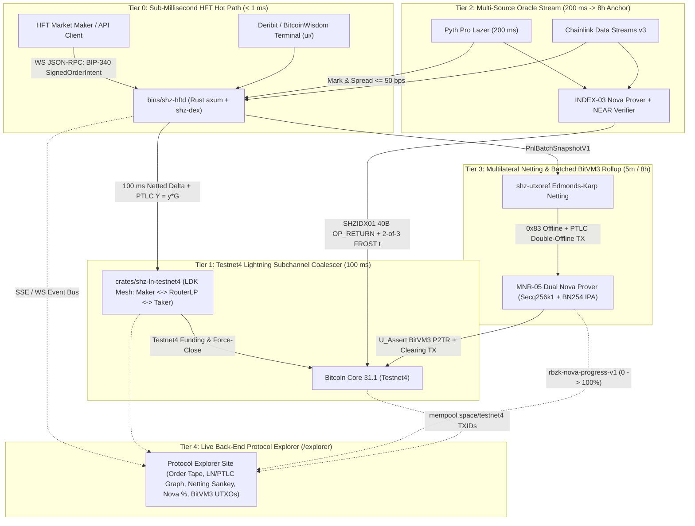

# SatsHedgeZero (SHZ) Product Roadmap & Completion Matrix

> **Snapshot Date:** 2026-11-24  
> **Target Product:** Non-custodial High-Frequency Trading (HFT) API & Deribit/BitcoinWisdom Terminal over Testnet4 Lightning (`LN-DLC` + `PTLC`), backed by Multi-Source Oracle Provenance (`Pyth Pro` + `Chainlink` + `NEAR`), Multilateral Netting (`UTXORef`), Batched `BitVM3` Taproot Settlement, and a Real-Time Back-End Protocol Explorer.  
> **Overall Completion (Testnet4 HFT + Explorer Beta Scope):** **`64%`** (`~85%` cryptographic/settlement core, `~40%` live HFT transport/LDK/Explorer layer; `production_ready: false` for Mainnet).

---

## 1. Component Completion Matrix

| # | Product Track | Modules / PRs | % Complete | Verified Today | Remaining to 100% |
|---|---|---|---:|---|---|
| **1** | **Inverse Margin, Option/Swap & DLC Core** | `crates/shz-margin`, `crates/shz-dlc` | **92%** | Exact integer inverse perp/swap/option payouts, prefix-compressed CET ranges, BIP-340 Schnorr + verified adaptor extraction (`adaptor_extract_secret_verified`), `LnDlcSubchannel` state machine | Cross-margin portfolio Greeks across multi-expiry options; partial-liquidation auction curves |
| **2** | **Oracle Provenance & NEAR Transparent Verifier** | `crates/shz-oracle`, `research/hourly_index_nova_03` (PR #9, #10, #19) | **85%** | Solana `pyth-lazer` Ed25519 PDA + Chainlink v3 `ecrecover` + TradeLayer wash-filtered VWAP + `2-of-3`/`3-of-5` FROST + `SHZIDX01` Bitcoin SPV headers + BN254 Nova/Spartan/IPA verified in `near-sandbox@0.3.5` | Always-on 24/7 oracle relayer service; compress NEAR verification below `1,129` chunk txs via batched MSM / optimistic bisection |
| **3** | **Multilateral Netting, Offline `0x83` & PTLC Clearing** | `crates/shz-utxoref`, `bins/shz-cli`, `research/mnr05_bitvm3_ln_dlc` (PR #5, #21) | **88%** | Edmonds-Karp max-flow PnL solver, 6-block reorg-safe `DurablePnlBatchBook`, Bob-offline `0x83` clearing broadcast on **live Bitcoin Testnet4** & Core 31.1, Gate 3 PTLC swap with **both Bob & Alice offline** | Arbitrary $N$-party ($N > 3$) dynamic transaction packer; standalone automated watchtower daemon for `CLTV` unilateral exits |
| **4** | **BitVM3 Taproot Settlement & Setup-Free Nova Provers** | `crates/shz-nova-bitvm`, `research/mnr05_bitvm3_ln_dlc` (PR #7, #8, #21) | **78%** | Native-field `Secq256k1` 8-sig BIP-340 SNARK (`11,980 B`, 0 foreign-field emulation), `Bn256EngineIPA` 3-fold Unified Batch + Sparse Nullifier SNARK (`12,784 B`), `304 B` statement, Core 31.1 4-leaf `BitVm3AssertionTree` (`CSV` reclaim + `72 B` boundary & `52 B` equivocation slashes), live `0->100%` prover telemetry | In-circuit `TapSighash` derivation inside `Secq256k1`; full L1 garbled-circuit SNARK gate disprover (`M13/M14`, currently `full_groth16_garbled_circuit_l1_verified: false`) |
| **5** | **HFT Matching Daemon & Low-Latency WS/REST API** | `crates/shz-dex`, `ui/server.mjs` -> `bins/shz-hftd` | **45%** | Deterministic 0-fee P2P `SignedOrderIntent` book, BIP-340 intent auth, price-time matching, HTTP workbench API | Persistent Rust `axum`/`tokio` WS + REST server (`< 1 ms` ack, `private/mass_quote`, `cancel_on_disconnect`), lock-free pre-trade LN margin gate, `shz-mm-bot` load generator |
| **6** | **Live Testnet4 Lightning (`LDK`) Mesh & `100 ms` Coalescer** | `crates/shz-dlc` -> `crates/shz-ln-testnet4` | **30%** | `LnDlcSubchannel` off-chain close/CET math, PTLC secret extraction, live WSL Bitcoin Testnet4 wallet/RPC integration | Embedded `ldk-node` Testnet4 peer cluster (`Maker <-> RouterLP <-> Taker`), BOLT-11 / custom PTLC wire TLVs, `100 ms` micro-batch subchannel state coalescer |
| **7** | **Trading Terminal & Back-End Protocol Explorer** | `ui/public/` -> `ui/public/explorer.html` | **50%** | Deribit-layout terminal with BitcoinWisdom aesthetic & animated orderbook/candle ticks, contract workbench, desktop `rbzk-prover-ui` `%` console | Dedicated `/explorer` web UI streaming live HFT intents (`µs`), LN/PTLC channel balances, Edmonds-Karp netting Sankey, `SHZIDX01` `mempool.space/testnet4` anchors, and live Nova/Nullifier/BitVM3 state |
| **8** | **Chaos Engineering, Audits & Mainnet Readiness** | R1CS & Core 31.1 adversarial suites | **20%** | 32+ R1CS adversarial mutation tests (`INDEX-03` + `MNR-05`), Core 31.1 1-sat shave/swap/CSV/griefing rejections, 6-block reorg freeze drill | Continuous multi-bot chaos arena under LN/L1 partitions, HSM signer isolation, external cryptographic audit (`production_ready: false`) |

---

## 2. End-to-End Architecture & Speed Tiers



---

## 3. Phased Product Delivery Roadmap (Remaining `36%` to Public Testnet4 Beta)

### Milestone M1 — `SHZ-HFT-01`: Rust Low-Latency WS/REST Matching Engine (`64% -> 73%`)
- **Deliverables:**
  - `bins/shz-hftd`: Persistent `tokio` + `axum` server exposing `ws://.../v1/ws` and `/v1/api/*`.
  - Endpoints: `public/subscribe` (`book.BTC-USD-INV.raw`, `trades`, `oracle.200ms`), `private/place_intent`, `private/mass_quote` (up to 40 two-sided quotes/frame), `private/cancel`, `private/cancel_all`, `private/positions`.
  - Pre-trade lock-free margin check against each trader's reserved Testnet4 LN balance.
  - `bins/shz-mm-bot`: Automated two-sided market-maker + taker benchmark CLI.
- **Exit Gate:** Sustained `>= 5,000` BIP-340 signed intents/sec, `p99 < 1.5 ms` localhost match ack.

### Milestone M2 — `SHZ-HFT-02`: Live Testnet4 Lightning (`LDK`) Margin & `100 ms` Coalescer (`73% -> 83%`)
- **Deliverables:**
  - `crates/shz-ln-testnet4`: Embedded `ldk-node` cluster (`Maker`, `Taker`, `RouterLP`) backed by Testnet4 `bitcoind`.
  - Real Testnet4 BOLT-11 margin deposits and instant off-chain PTLC PnL withdrawals (`adaptor_extract_secret_verified`).
  - `100 ms` asynchronous subchannel commit coalescer collapsing high-frequency fills into a single `(net_usd_delta, vwap_entry_usd)` bilateral commitment per channel tick so CET/adaptor signing never blocks order matching.
- **Exit Gate:** 1,000 HFT fills executed across live Testnet4 LN channels with `< 1 ms` API ack and verified `100 ms` asynchronous channel state convergence.

### Milestone M3 — `SHZ-EXP-03`: Live Back-End Protocol Explorer Site (`83% -> 92%`)
- **Deliverables:**
  - `ui/public/explorer.html` + `/v1/explorer/stream` unified telemetry feed alongside the trading terminal:
    1. **Order & Match Tape:** `order_id`, x-only pubkey, BIP-340 signature check, match latency (`µs`), coalesced LN sequence `#`.
    2. **Testnet4 LN & PTLC Topology:** Live channel capacities, DLC margin locks, active $Y = y \cdot G$ adaptor locks, and scalar $y$ extraction events.
    3. **Edmonds-Karp Netting Visualizer:** Gross obligations vs. compressed multilateral L1 outputs (`% collateral freed`, offline `0x83` / PTLC badges).
    4. **Oracle & Anchor Inspector:** Live `200 ms` Pyth/Chainlink spread meter (`<= 50 bps`), 8h Merkle path, `2-of-3` FROST shares, and `mempool.space/testnet4` `SHZIDX01` links.
    5. **Nova `%` & BitVM3 UTXO Inspector:** Browser-native `0% -> 100%` `Secq256k1` + `BN254` fold bars, 8-slot Sparse Nullifier tree (`EMPTY -> CONSUMED`), and `BitVm3AssertionTree` leaf/CSV status.
- **Exit Gate:** Every state transition from HFT click/bot quote to Testnet4 `txid` and Nova SNARK hash is inspectable in `< 1 s` in `/explorer`.

### Milestone M4 — `SHZ-HFT-04`: Automated Testnet4 Rollup Scheduler & Watchtower (`92% -> 97%`)
- **Deliverables:**
  - Rolling `5-minute` Testnet4 HFT settlement epochs + canonical `8-hour` `SHZIDX01` checkpoints.
  - Automated Challenger Watchtower scanning Testnet4 `U_Assert` outputs and auto-broadcasting `disprove_boundary_tx` / `disprove_equivocation_tx` or `CLTV` unilateral fallbacks on injected faults.
- **Exit Gate:** Unattended 24-hour Testnet4 multi-bot trading run with verifiable `mempool.space/testnet4` anchor, clearing, and BitVM3 assertion TXIDs.

### Milestone M5 — `SHZ-PROD-05`: Full L1 Garbled Verifier & Security Audit (`97% -> 100%` Beta / Mainnet Gate)
- **Deliverables:**
  - In-circuit `TapSighash` reconstruction inside `Secq256k1` + `M13/M14` garbled-circuit Tapleaf integration (`full_groth16_garbled_circuit_l1_verified: true`).
  - HSM/remote-signer isolation and external cryptographic & Bitcoin Script audit before flipping `production_ready: true`.

---

## 4. Honesty & Capability Flags (Current Repo State)

```json
{
  "overall_testnet4_hft_explorer_roadmap_pct": 64,
  "core_dlc_margin_oracle_crypto_pct": 85,
  "live_hft_ws_ldk_explorer_pct": 40,
  "trusted_setup_ceremony": false,
  "testnet4_bob_offline_0x83_broadcast_verified": true,
  "core31_ptlc_double_offline_clearing_verified": true,
  "core31_bitvm3_tapscript_disprove_verified": true,
  "near_sandbox_transparent_nova_verified": true,
  "full_groth16_garbled_circuit_l1_verified": false,
  "live_ldk_testnet4_hft_daemon_shipped": false,
  "production_ready": false
}
```
